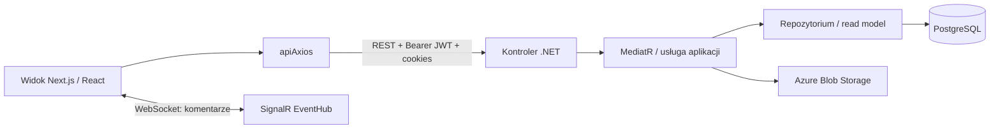

# Event Marketplace — przegląd projektu

> **Stan przeglądu:** 24 października 2026 r.  
> **Zakres:** statyczny przegląd kodu frontendu i backendu. Nie uruchamiałem aplikacji ani testów. W trakcie przeglądu nie zmieniałem kodu aplikacji.

## W skrócie

Projekt ma sensowny kierunek architektoniczny i już obejmuje istotny przepływ: konta i role, wydarzenia, panele organizatora i administratora, bazę PostgreSQL, upload zdjęć oraz komentarze w czasie rzeczywistym. Backend ma wyraźny podział na warstwy, a frontend ma czytelny podział tras według rodzaju użytkownika.

**Ocena etapu: MVP w budowie / wczesna wersja funkcjonalna.** Fundamenty są mocniejsze niż kompletność produktu. Najważniejsze przed dalszym rozwojem są: domknięcie kontroli dostępu w API, uzgodnienie tras i kontraktów frontend–backend, uzupełnienie niedokończonych ekranów oraz aktywne testy przepływów krytycznych.

## Jak projekt jest zorganizowany

### Frontend

Frontend używa Next.js App Router, React 19, TypeScriptu, Redux Toolkit, Axiosa, Styled Components i Tailwinda.

| Miejsce | Rola |
| --- | --- |
| `src/app/(public)` | Publiczna strona główna i katalog wydarzeń |
| `src/app/(auth)` | Logowanie i rejestracja |
| `src/app/(protected)` | Dashboard oraz widoki użytkownika, organizatora i administratora |
| `src/components` | Wspólne layouty, dashboard i komponenty interfejsu |
| `src/lib/apiAxios.ts` | Klienci HTTP, nagłówki JWT i odświeżanie tokenu |
| `src/lib/signalR` | Połączenie czasu rzeczywistego |
| `src/redux` | Stan access tokenu, identyfikatora użytkownika i ról |
| `src/services`, `src/context`, `src/types` | Funkcje pomocnicze, kontekst i typy |

Strony są zwykle cienkimi punktami wejścia, a widoki i logika ekranu leżą w podkatalogach `components`. Przykładowo zarządzanie wydarzeniami organizatora jest w `src/app/(protected)/event/list`, a przegląd wydarzeń administratora w `src/app/(protected)/admin-panel/events`.

### Backend

Backend to .NET 9 Web API z PostgreSQL, Entity Framework Core, MediatR/CQRS, FluentValidation, AutoMapper, SignalR i Azure Blob Storage.

| Projekt | Rola |
| --- | --- |
| `EventMarketplace` | API, kontrolery, konfiguracja aplikacji i middleware |
| `EventMarketplace.Application` | Przypadki użycia, komendy i zapytania, walidacja oraz usługi |
| `EventMarketplace.Domain` | Encje, enumy, value objects i interfejsy repozytoriów |
| `EventMarketplace.Infrastructure` | EF Core, repozytoria, PostgreSQL, JWT, Blob Storage i SignalR |
| `EventMarketplace.Tests` | Testy jednostkowe i integracyjne |

W większości przypadków kontroler przekazuje komendę lub zapytanie do MediatR, warstwa aplikacji realizuje przypadek użycia, a infrastruktura zapisuje lub odczytuje dane. Odczyty panelu administratora korzystają też z Dappera.

### Przepływ żądania

## Co już działa i wygląda dobrze

- Trasy frontendu są pogrupowane według dostępu i funkcji; wspólne layouty ograniczają powielanie nawigacji.
- Backend oddziela domenę od dostępu do danych i szczegółów infrastruktury. Komendy i zapytania są w dużej mierze rozdzielone.
- API obsługuje rejestrację, logowanie, odświeżanie tokenu, CRUD wydarzeń, statusy i podstawowe statystyki administratora.
- Refresh token jest ustawiany jako cookie `HttpOnly`; access token trafia do nagłówka `Authorization`.
- Upload zdjęć wydarzeń i komentarze na żywo mają już integracje z usługami zewnętrznymi / SignalR.
- Backend ma middleware mapujące błędy domenowe i walidacyjne na odpowiedzi HTTP.

## Najważniejsze problemy do poprawienia

### P0 — bezpieczeństwo i poprawność dostępu

1. **Dane użytkownika są dostępne bez jawnej autoryzacji.** `UserController` nie ma `[Authorize]`, a `GET api/User/user-info` przyjmuje adres e-mail z query i zwraca m.in. imię, nazwisko, telefon i adres. To umożliwia odczytanie danych innych osób, jeśli endpoint jest osiągalny. Wprowadź autoryzację oraz pobieraj tożsamość z JWT; dostęp administracyjny do listy użytkowników wydziel osobno.

2. **Edycja i usuwanie wydarzenia nie sprawdzają właściciela.** `EventController` wymaga zalogowania, ale `EditEvent` i `DeleteEvent` przekazują ID do `EventManagementService`, który nie porównuje organizatora wydarzenia z ID użytkownika z tokenu. Podobnie utworzenie i wysłanie wydarzenia do akceptacji nie mają jawnego `[Authorize(Roles = "Organizer")]`. Dodaj kontrole roli i właściciela po stronie backendu; ukrywanie przycisków w UI nie jest zabezpieczeniem.

3. **Statystyki administratora wymagają tylko zalogowania.** `AdminController` ma `[Authorize]`, bez ograniczenia do roli `Admin`. Endpointy statystyk i alertów mogą więc być dostępne każdemu zalogowanemu użytkownikowi. Ogranicz kontroler lub konkretne akcje do roli administratora.

4. **Token jest wypisywany w konsoli przeglądarki.** `LoginView.tsx` wykonuje `console.log("accessToken", data)`, gdzie `data` zawiera `tokenJwt`. Usuń ten log przed wdrożeniem i sprawdź logi innych ekranów pod kątem danych osobowych i tokenów.

### P1 — niespójności między frontendem i API

1. **Publiczny katalog odpytuje chroniony endpoint.** Publiczna strona `/events-public` wywołuje `GET api/Event`, ale cały `EventController` ma `[Authorize]`. Bez JWT katalog otrzyma 401. Zdecyduj, które odczyty są publiczne, i oznacz je `[AllowAnonymous]` albo użyj osobnego endpointu.

2. **Żądanie usunięcia ma błędny URL.** Frontend składa `Event/{${id}}`, np. `Event/{abc}`; backend oczekuje `DELETE api/Event/{id}` bez nawiasów klamrowych. Poprawienie tego wymaga też dodania opisanej wyżej autoryzacji właściciela.

3. **Odczyt statusów nie awaituje zapytania.** W `EventController.GetAllEventStatuses` jest `Ok(mediator.Send(...))`, zamiast oczekiwanego `Ok(await mediator.Send(...))`. W obecnej formie odpowiedź może serializować obiekt `Task`, a nie listę statusów. Sprawdź i ujednolić odpowiedź z tym, czego oczekuje frontend.

4. **Format błędów jest niespójny.** Middleware zwraca `message` i `errorCode`, a logowanie w `LoginView` szuka `error`. Frontend często kończy więc na ogólnym komunikacie. Uzgodnij jeden schemat błędów i użyj go w całej aplikacji.

5. **Adres SignalR jest na stałe ustawiony na localhost.** `SignalRProvider.tsx` łączy się z `http://localhost:5141/eventHub`; w innym środowisku połączenie będzie wskazywało niewłaściwy serwer, a HTTPS może blokować niezabezpieczony WebSocket. Przenieś adres huba do konfiguracji środowiskowej i użyj właściwego protokołu.

6. **CORS API jest ograniczony do `http://localhost:3000`.** To pasuje do lokalnego uruchomienia, ale trzeba skonfigurować origin wdrożonego frontendu. Współgrają z tym credentials, więc nie należy zastępować jawnego originu wildcardem.

### P2 — kompletność i utrzymanie

- `OrganizersPanel.jsx` wyświetla tylko nagłówek „Organizatorzy”; panel uczestnika również jest placeholderem.
- Przyciski ustawień, powiadomień i profilu w panelu admina wykonują tylko `console.log`; paginacja listy admina ma pusty handler, a dane paginacji są przykładowe.
- W projekcie frontendu powtarzają się wywołania API w komponentach. Warto zebrać je w modułach funkcji/serwisów z typami requestów i odpowiedzi.
- Obsługa ładowania i błędów jest nierówna; część komponentów jedynie wypisuje ogólne `console.log("error")`.
- Testy backendu są obecne, ale przegląd plików pokazuje wiele zakomentowanych testów. Nie oceniałem ich wykonania. Uzupełnij aktywne testy autoryzacji, własności wydarzenia, refresh tokenu i kontraktów API.

## Na jakim etapie jest projekt

**Projekt jest czymś więcej niż makietą, ale nie wygląda jeszcze na gotowy produkt.** Backend zawiera znaczną część logiki biznesowej, schemat bazy, migracje i integracje. Frontend potrafi przeprowadzić użytkownika przez część głównych ekranów i przepływów. Jednocześnie widoczne są niedokończone panele, tymczasowe handlery oraz krytyczne rozjazdy w dostępie do API.

Najtrafniejszy opis to **MVP / wczesny etap integracji i stabilizacji**. Przed udostępnieniem szerszej grupie użytkowników należy zamknąć kwestie bezpieczeństwa i zgodności kontraktów. Nie da się na podstawie samego kodu potwierdzić, że projekt jest uruchamialny w środowisku wdrożeniowym; nie sprawdzałem konfiguracji sekretów, usług ani działania aplikacji.

## Proponowana kolejność dalszych prac

1. **Zamknąć dostęp do danych i operacji:** autoryzacja `UserController`, role dla admina/organizatora, sprawdzanie właściciela przy edycji/usuwaniu/wysyłaniu wydarzenia, usunięcie logowania tokenów.
2. **Uzgodnić kontrakt API:** publiczność katalogu, ścieżki endpointów, schemat błędów, odpowiedź listy statusów, konfiguracja adresów REST i SignalR.
3. **Dodać aktywne testy krytycznych reguł:** brak dostępu do cudzych danych i wydarzeń, uprawnienia ról, odświeżanie i unieważnianie tokenów, podstawowe przepływy wydarzeń.
4. **Dokończyć ścieżkę użytkownika:** panel organizatorów i uczestnika, akcje admina, paginacja, czytelne stany ładowania i błędów.
5. **Ustandaryzować frontend:** wspólna warstwa API, wspólne typy kontraktów, ograniczenie logów debugujących i weryfikacja konfiguracji produkcyjnej.

## Punkty odniesienia w repozytorium

- Frontend: `src/lib/apiAxios.ts`, `src/lib/signalR/SignalRProvider.tsx`, `src/redux/auth/authSlice.ts`, `src/app/(protected)/admin-panel/organizers/components/OrganizersPanel.jsx`.
- Backend: `Backend/EventMarketplace/EventMarketplace/Controllers`, `Backend/EventMarketplace/EventMarketplace.Application/Services/Events/Management/EventManagementService.cs`, `Backend/EventMarketplace/EventMarketplace.Application/Extensions.cs`.
- Opis backendu w `Backend/EventMarketplace/README.md` deklaruje Clean Architecture i funkcje produktu; ten dokument ocenia stan widoczny w kodzie, który może być bardziej aktualny niż README.

---

*Dokument jest przeglądem statycznym, a nie audytem bezpieczeństwa ani raportem z testów. Wskazane problemy wynikają z widocznego kodu i powinny być potwierdzone testami integracyjnymi po poprawkach.*
